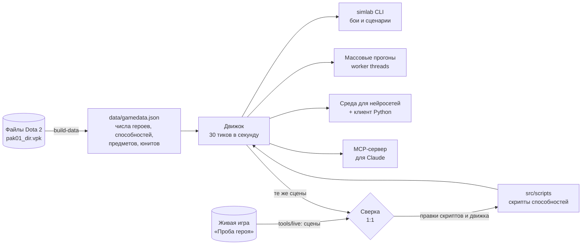

<div align="center">

# Dota 2 SimLab

**Расчётная песочница боёв Dota 2 для массовых симуляций и обучения нейросетей**


«Проба героя» без графики: любой герой, юнит, предмет, уровень, таланты, Аганим и Шард, приказы по времени,
точный журнал боя. Один бой считается за доли миллисекунды, миллион сценариев около минуты.

</div>

## Главное

- **Все 127 героев патча 7.42**: каждая способность, талант, Scepter и Shard; 255 предметов и нейтральных предметов;
  202 способности крипов, призывов и Рошана.
- **Числа берутся прямо из файлов игры** (`pak01_dir.vpk`), а поведение способностей **сверено с живой игрой**: каждая
  способность записана в «Пробе героя» и в симуляторе, сравнён каждый экземпляр урона, каст, мана, перезарядка,
  состояние и стат. Совпадают 72% сцен героев и 88% сцен предметов, причины остальных расписаны в [EVIDENCE.md](EVIDENCE.md).
- **Для нейросетей**: среда с наблюдениями и действиями (JSON lines), клиент на Python, детерминированные бои по seed.
- **Для Claude**: MCP-сервер `dota-sandbox` с интерактивной песочницей и массовыми прогонами.
- **Без зависимостей**: чистый Node.js 20+, работает на Windows, macOS и Linux.



**Чем это не является.** Это не копия игры: здесь нет карты, графики, звука и кода Valve. Из игры берутся только числа
(характеристики, способности, предметы), а правила боя написаны заново и сверены с живой игрой. Бой идёт на ровной
площадке: нет рельефа, деревьев, тумана войны, линий, золота, опыта и возрождения. Для сверки в папку игры временно
кладутся Lua-скрипты рекордера, после сверки они удаляются; память игры не читается и не меняется.

## Что внутри

| Содержимое | Всего | Как смоделировано |
|---|---|---|
| Герои | 127 | у всех есть скрипт каждой способности; характеристики, рост и атака точные |
| Способности героев | 790 | полностью 300, с упрощениями 424, частично 25, не имеют смысла на арене 41 |
| Таланты | 1016 | работают 1014; два без эффекта (общий обзор от Track, Toss без цели) |
| Предметы из магазина | 190 | полностью 71, с упрощениями 42, частично 5, вне арены 13, чистые бонусы характеристик 59 |
| Нейтральные предметы и зачарования | 67 | полностью 29, с упрощениями 25, частично 6, вне арены 3, чистые бонусы 4 |
| Способности крипов и призванных существ | 202 | полностью 81, с упрощениями 64, частично 15, вне арены 42 |

Что значат метки (они стоят на каждом скрипте, полный список в [COVERAGE.md](COVERAGE.md)):

- **полностью** (`full`): смоделирован каждый пункт подсказки;
- **с упрощениями** (`approx`): все пункты есть, но упрощена геометрия или время либо сделано оговорённое допущение;
- **частично** (`partial`): какого-то пункта подсказки нет (в отчёте написано, какого именно);
- **вне арены** (`n/a`): эффект не имеет смысла в бою на площадке (золото, телепорт по карте, обзор, кнопки отмены).

## Что проверено

| Проверка | Результат |
|---|---|
| Характеристики 1-го уровня всех 127 героев против опубликованных цифр Valve | совпадение полное |
| Все 127 героев: 36 боёв каждому на уровнях 1–30, с Аганимом и без | без ошибок; каждая применяемая способность, кроме помеченных как ручные, сработала хотя бы раз |
| Все предметы из данных (432 без рецептов) и 356 юнитов | надеваются, спавнятся и дерутся без ошибок |
| Случайные бои: до трёх героев на сторону, случайные предметы, таланты, правила | 550 000 боёв двумя прогонами с разными зёрнами: 0 ошибок. До этого такой прогон нашёл три зацикливания отражённого урона; они исправлены и добавлены в тесты. После сверки с игрой ещё 220 000 боёв: 0 ошибок |
| Повторяемость | один и тот же seed даёт тот же бой; результат не зависит от числа потоков |
| Скорость | 999 998 сценариев (все герои против всех, 62 повтора, 20-й уровень, все способности) за 79 с на 6 потоках из 12 (12 654 в секунду), 0 ошибок; до сверки с игрой было 57 с, движок стал считать больше по тикам |
| **Сверка с живой игрой** («Проба героя», клиент 6983) | способности героев: 1077 из 1495 сцен совпали полностью (урон каждого удара, касты, мана, перезарядки, состояния, статы); предметы: 320 из 365; статы всех героев на уровнях 1–30 совпадают; подробности и причины расхождений в [EVIDENCE.md](EVIDENCE.md) |

Запуск тестов: `node tests/run.mjs` (57 проверок). Сверка с игрой без запуска игры (по записанным сценам): `node tools/live/compare_all.mjs --hero <герой>`. Случайные бои: `node tools/fuzz.mjs --n 20000 --workers 6`.

## Насколько этому можно верить

- **Точно** (сверено с цифрами Valve или взято прямо из данных игры): базовые характеристики, рост по уровням, значения
  способностей с талантами, Scepter и Shard, бонусы предметов вида «+урон / +сила / +броня».
- **Сверено с живой игрой**: для каждой способности героя записана сцена в «Пробе героя» и та же сцена в симуляторе;
  72% сцен совпали полностью, у предметов 88%. Остальное — в основном случайные роллы атак, позиции (нет поворота и
  столкновений) и время полёта снарядов; правила, которые установлены измерением, помечены в коде `[L]`. Способности
  крипов и призывов: 41 из 148 сцен (37 событийных юнитов в игре нет; у Рошана расходится только то, на каком ударе сработал баш). Timbersaw и часть сцен Io не записаны: клиент вылетал.
- **Нет вообще**: карта, рельеф, деревья, обзор и True Sight, поворот юнитов, золото и опыт, возрождение, строения с их
  логикой, столкновения юнитов. Страх лишает действий, но юнит стоит на месте. Встроенный ИИ простой: ближайшая цель, все готовые
  способности по приоритету, иначе автоатака.
- Откуда взята каждая формула и какие сделаны допущения: [EVIDENCE.md](EVIDENCE.md).

В данных игры остались и предметы, которых нет в текущем патче (старые нейтральные, событийные, удалённые): их можно
выдать, но работают только бонусы характеристик, а в результате такой предмет попадёт в поле `notModelled`.

Каждый результат содержит поле `partiallyModelled`: способности участников, у которых не хватает пункта подсказки.
Если вывод зависит от такой способности, его нужно перепроверить.

## Для нейросетей

Тот же движок доступен как среда с пошаговым управлением (`reset` / `step` / `observe`): агент получает наблюдение,
отдаёт приказы своим юнитам, среда проматывает время и возвращает новое наблюдение, награду и признак конца эпизода.
Противника можно оставить встроенному ИИ или тоже отдать агенту.

```powershell
.\simlab.cmd env
```

Протокол (одна строка JSON на запрос), действия, наблюдение, вектор фиксированной длины и награда описаны в
[docs/ENV.md](docs/ENV.md). Готовый клиент на Python без зависимостей: `clients\python\simlab_env.py`.
Один процесс делает около 3 000 шагов в секунду; для обучения запускайте несколько процессов и шагайте пачками (`step_many`).

## Подключение к Claude (MCP)

Сервер зарегистрирован в Claude Code на уровне пользователя под именем `dota-sandbox`, поэтому доступен в любых новых сессиях.

| Инструмент | Что делает |
|---|---|
| `sim_info` | сборка данных, покрытие, памятка по формату сценариев |
| `sim_list` | списки героев, юнитов, предметов, нейтральных предметов |
| `sim_describe` | данные и текущее описание героя, предмета или способности |
| `sim_sheet` | «лист персонажа»: здоровье, броня, урон, скорость атаки, DPS, EHP |
| `sim_run` | один бой с итогом и журналом боя |
| `sim_batch` | массовый прогон: вариации × повторы, статистика по каждой вариации |
| `sim_matrix` | все из списка A против всех из списка B, матрица побед |
| `sim_job` | статус фонового прогона |
| `sandbox` | интерактивная песочница: спавн, предметы, приказы, шаг времени, состояние |
| `sim_coverage` | точность модели: метка и пояснение по каждой способности героя |

Проверить: `claude mcp get dota-sandbox`. Удалить: `claude mcp remove dota-sandbox -s user`.

## Командная строка

Из папки `Dota2_sandbox` (нужен Node.js 20+, он уже установлен):

```powershell
.\simlab.cmd info
```

```powershell
.\simlab.cmd sheet phantom_assassin --level 20 --items desolator,black_king_bar
```

```powershell
.\simlab.cmd run scenarios\pa_vs_sven.json --log
```

```powershell
.\simlab.cmd batch scenarios\sven_item_choice.json --workers 6
```

```powershell
.\simlab.cmd matrix --a sven,juggernaut,ursa --b axe,lina,sniper --level 20 --runs 500
```

```powershell
.\simlab.cmd coverage lina
```

```powershell
.\simlab.cmd bench --runs 1000000 --workers 6
```

Остальные команды: `.\simlab.cmd help`.

## Формат сценария

```json
{
  "units": [
    { "id": "pa", "team": 0, "unit": "phantom_assassin", "level": 20,
      "items": ["desolator", "black_king_bar", { "name": "power_treads", "attr": "agi" }],
      "neutral": ["serrated_shiv", "enhancement_brawny"],
      "talents": "1-2-1-2", "scepter": false, "shard": true },
    { "id": "sven", "team": 1, "unit": "Sven", "level": 20, "items": ["echo_sabre", "greater_crit"], "ai": "fight" },
    { "id": "creep", "team": 1, "unit": "npc_dota_neutral_centaur_khan", "count": 2 }
  ],
  "rules": { "maxTime": 120, "end": "team_dead", "gameTime": "30:00" },
  "distance": 600
}
```

- Имена принимаются в любом виде: `sven`, `npc_dota_hero_sven`, `Sven`, `Black King Bar`, `item_desolator`.
- `talents`: `none`, `first`, `second`, `all`, строка вида `1-2-1-2` (выбор на 10/15/20/25) или список названий.
- `skills`: явная прокачка, например `{ "sven_storm_bolt": 4 }`. Без неё очки распределяются стандартно: ультимейт при
  первой возможности, остальные способности поровну, лишние очки идут в атрибуты.
- `ai`: `fight` (кастует всё и бьёт), `attack` (только автоатака), `idle` (манекен) либо объект
  `{ "mode": "fight", "focus": "lowest_hp", "target": "sven", "abilities": "all", "items": ["black_king_bar"], "order": ["..."] }`.
- `stacks`: стартовые заряды пассивных способностей и предметов, например `{ "nevermore_necromastery": 12 }`.
- `override`: принудительные значения юнита, например `{ "hp": 12000, "armor": 25 }`.
- `rules.gameTime`: игровое время. От него растут нейтральные крипы и Рошан (здоровье, урон, броня), а способности
  крипов получают 2-й уровень с 15:00 и 3-й с 30:00.
- `rules.freeSpells`: без маны и кулдаунов. `rules.detectAll: false`: невидимость действительно скрывает юнитов.
  `rules.day: false`: ночь.

## Массовые прогоны

```json
{
  "name": "sven_item_choice",
  "scenario": { "units": [ { "id": "a", "team": 0, "unit": "sven", "level": 20 }, { "id": "b", "team": 1, "unit": "axe", "level": 20 } ] },
  "vary": { "units.0.items": [["desolator"], ["greater_crit"], ["skadi"]], "units.1.unit": ["axe", "sniper", "lina"] },
  "runs": 1000, "seed": 1, "workers": 6
}
```

`vary` перебирает все сочетания, `zip` двигает списки синхронно. Всего сценариев = вариации × `runs`.
Полные результаты сохраняются в `results\*.json`, в ответе показываются первые строки.

## После выхода нового патча

Данные собираются прямо из архивов установленной игры (только чтение), обновление занимает секунду:

```powershell
.\simlab.cmd build-data
```

```powershell
node tests\run.mjs
```

```powershell
.\simlab.cmd coverage --write
```

Числа способностей и предметов обновятся сами. Если Valve изменит механику способности (а не только цифры),
её скрипт в `src\scripts\` нужно поправить вручную: правила и приёмы описаны в [docs/AUTHORING.md](docs/AUTHORING.md).

## Что где лежит

| Путь | Содержимое |
|---|---|
| `simlab.cmd` | запуск из командной строки |
| `data\gamedata.json` | скомпилированные данные игры (герои, юниты, предметы, способности) |
| `data\descriptions.json` | тексты описаний способностей (для справки, движком не используются) |
| `src\engine\` | ядро: юниты, характеристики, атака, урон, эффекты, прокачка, ИИ |
| `src\scripts\` | способности героев (`heroes_1` … `heroes_12`), предметы (`items`, `items_2`, `neutral_1`), крипы (`units`, `units_2`) |
| `src\data\` | чтение архивов игры и сборка данных |
| `src\batch.mjs`, `src\worker.mjs` | параллельные прогоны |
| `src\env.mjs`, `clients\python\` | среда для нейросетей и клиент на Python |
| `src\mcp.mjs`, `src\sandbox.mjs` | MCP-сервер и интерактивная песочница |
| `scenarios\` | примеры сценариев |
| `tests\run.mjs`, `tests\regressions.json` | автотесты и бои, которые когда-то ломались |
| `tools\hero_check.mjs`, `tools\unit_check.mjs`, `tools\fuzz.mjs` | проверка героев, юнитов и предметов, случайные бои |
| `tools\digest.mjs` | данные и описания способностей героя в сжатом виде |
| `docs\AUTHORING.md`, `docs\ENV.md` | как писать скрипты способностей; протокол среды |
| `COVERAGE.md`, `EVIDENCE.md` | точность по каждой способности; источники формул, сверка с игрой и допущения |
| `tools\live\`, `docs\LIVE_VERIFICATION.md` | сверка с живой игрой: рекордер для «Пробы героя», сцены, записи, сравнение |
| `tools\live\out\scenes\` | записи всех сцен из живой игры (сравнение работает без запуска игры) |
| `results\` | результаты прогонов (в репозиторий не входят) |

## Права

Dota 2, её данные, названия и тексты принадлежат Valve Corporation. Проект неофициальный, с Valve не связан и
предназначен для исследований и анализа. Код игры здесь не используется: из файлов игры читаются только числа.
